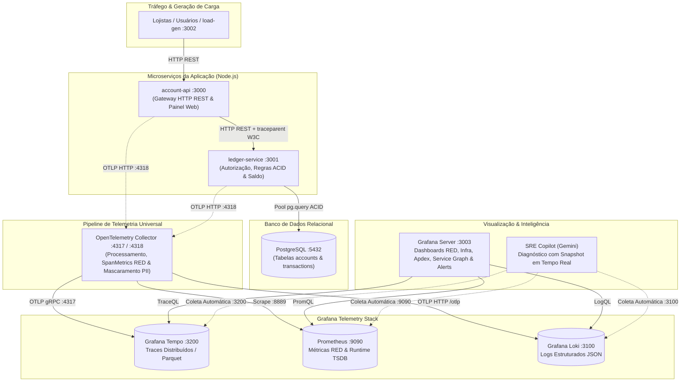

# 🏦 Bank Account Simulator — Observabilidade Completa & Grafana Stack

[](https://nodejs.org/)
[](https://opentelemetry.io/)
[](https://grafana.com/)
[](https://prometheus.io/)
[](https://www.docker.com/)
[](https://ai.google.dev/)

Solução completa de observabilidade para uma plataforma bancária em microserviços construída em **Node.js + PostgreSQL**, instrumentada com **OpenTelemetry (OTel)** e visualizada através da **Grafana Stack (Prometheus, Grafana Tempo, Grafana Loki e Grafana)**, complementada por um **Copiloto de IA para SRE (Google Gemini)** plugado na telemetria em tempo real.

---

## 🚀 One-Click Deploy (Inicialização Rápida)

### Pré-requisitos
* **Docker** (v20+) e **Docker Compose** instalados na máquina.
* *(Opcional)* Chave de API do Google Gemini para o assistente de IA.

### 1. Clonar e Configurar Variáveis
```bash
git clone <url-do-repositorio>
cd bank-account-simulator

# Copiar arquivo de variáveis de ambiente
cp .env.example .env
```
> *(Opcional)* Se desejar utilizar o assistente de IA com sua própria chave, edite o `.env` e preencha `GEMINI_API_KEY=sua_chave`. Caso não preencha, toda a stack de observabilidade funcionará normalmente e a IA apresentará o snapshot completo coletado em tela com diagnóstico local.

### 2. Subir Toda a Stack (9 Containers)
```bash
docker compose up --build -d
```

### 3. Mapeamento de Portas e Acessos

| Serviço | URL | Descrição |
|---|---|---|
| **Painel da Aplicação Bancária** | [http://localhost:3000](http://localhost:3000) | Interface web do banco, simulador de incidentes, controle do gerador de carga e Assistente SRE IA |
| **Arquitetura & Blueprint Visual** | [http://localhost:3000/#arch](http://localhost:3000/#arch) | Diagramas interativos com Zoom/Pan: Fluxo da Aplicação, Stack de Telemetria e Comparativo Grafana Cloud |
| **Grafana** | [http://localhost:3003](http://localhost:3003) | Dashboards provisionados automaticamente (Sem senha / Admin anônimo ativo) |
| **Dashboard RED & Domínio** | [http://localhost:3003/d/bank-red-observability](http://localhost:3003/d/bank-red-observability) | Apdex, SLO (99.5%), Error Budget, Rate, Errors (4xx/5xx/Total), Duration P95 e Exemplars |
| **Dashboard de Infraestrutura & Runtime** | [http://localhost:3003/d/bank-infra-observability](http://localhost:3003/d/bank-infra-observability) | Memória RAM (RSS/Heap), Event Loop Lag, Saúde do OTel Collector e Séries ativas no TSDB |
| **Dashboard Service Graph & Topologia** | [http://localhost:3003/d/bank-service-graph](http://localhost:3003/d/bank-service-graph) | Mapa de dependências dinâmico (Node Graph) gerado via conector `servicegraph` |
| **Grafana Alerting** | [http://localhost:3003/alerting/list](http://localhost:3003/alerting/list) | Alertas nativos segregados por serviço: Erros 5xx e degradação de Apdex (`account-api` e `ledger-service`) |
| **Gerador de Carga (Load-Gen API)** | [http://localhost:3002/status](http://localhost:3002/status) | API de controle da geração de tráfego sintético (`POST /start` e `POST /stop`) |
| **Prometheus** | [http://localhost:9090](http://localhost:9090) | Backend de métricas e interface de consulta PromQL |
| **Tempo** | [http://localhost:3200](http://localhost:3200) | Backend de traces distribuídos |
| **Loki** | [http://localhost:3100](http://localhost:3100) | Backend de logs estruturados em JSON |
| **OpenTelemetry Metrics Scrape** | [http://localhost:8889/metrics](http://localhost:8889/metrics) | Exposição de métricas OpenMetrics com Exemplars embutidos |
| **PostgreSQL** | `localhost:5432` | Banco de dados relacional com persistência ACID das contas e transações |

---

## 🏛️ Arquitetura dos Microserviços & Pipeline de Telemetria



---

## 🧪 Roteiro de Demonstração & Testes de Incidentes (Chaos Engineering)

A aplicação conta com um painel de controle de incidentes interativo na interface web (`http://localhost:3000`):

1. **Incidente 1 (Latência 2s no Saque):**
   - Injeta um atraso simulado de 2 segundos na validação do saque.
   - *Onde ver:* No Grafana (`Duration P95` sobe) $\rightarrow$ Clique no **Exemplar** para abrir o trace no Tempo e ver o span atrasado.
2. **Incidente 2 (Queda do Banco 500 no Depósito):**
   - Simula esgotamento de conexões com o PostgreSQL exclusivamente na rota `/deposit`.
   - *Onde ver:* No painel `Errors 5xx` $\rightarrow$ Repare que a rota de saque e extrato continuam funcionando (Isolamento de Domínio de Falha).
3. **Incidente 3 (Falha de Rede 502 entre Microsserviços):**
   - Simula partição de rede entre `account-api` e `ledger-service`.
   - *Onde ver:* Logs de erro no Loki e traces com status `502 Bad Gateway`.
4. **Incidente 4 (Falha 500 no Ledger com Resiliência / Graceful Degradation):**
   - O `ledger-service` falha internamente com 500 na busca de extrato.
   - *O que acontece:* A `account-api` intercepta o erro e aplica **Fallback com Cache em Memória**, respondendo **HTTP 200** para o correntista. No Tempo, o span do ledger fica vermelho, mas o span do gateway fica verde com tag `resilience.fallback_applied=true`.

---

## 🔍 Amostragem de Traces (Sampling Configurado)

O projeto possui a arquitetura completa de amostragem pronta para ambientes corporativos:
* **Head-Based Sampling (Na Aplicação):** Configurado em `account-api/tracing.js` e `ledger-service/tracing.js` através de `ParentBasedSampler` e `TraceIdRatioBasedSampler`, parametrizável via variável de ambiente `OTEL_TRACES_SAMPLER_ARG` (padrão `1.0` / 100% para demonstração acadêmica).
* **Tail-Based Sampling (No Coletor):** Bloco documentado e estruturado em `config/otel-collector/otel-collector-config.yaml` (`processors.tail_sampling`) com políticas para coletar 100% de erros (5xx), 100% de transações com latência superior a 500ms e amostrar apenas 10% do tráfego comum de sucesso.

---

## 🛠️ Comandos Úteis de Operação

```bash
# Ver status de todos os 9 containers da stack
docker compose ps

# Visualizar logs em tempo real de um serviço específico
docker compose logs -f account-api
docker compose logs -f ledger-service
docker compose logs -f otel-collector

# Reiniciar um serviço após alterações
docker compose restart account-api

# Parar toda a stack sem perder volumes
docker compose down

# Limpar completamente a stack e volumes de banco/telemetria
docker compose down -v
```
